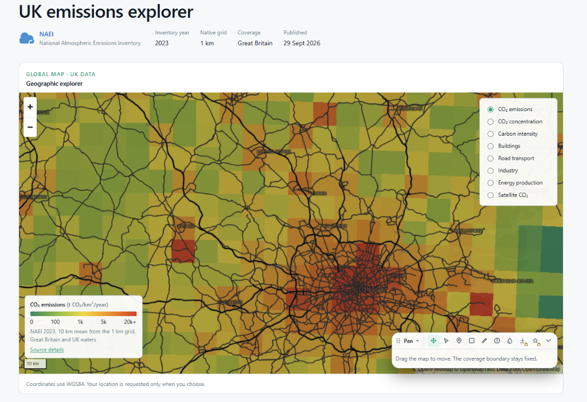
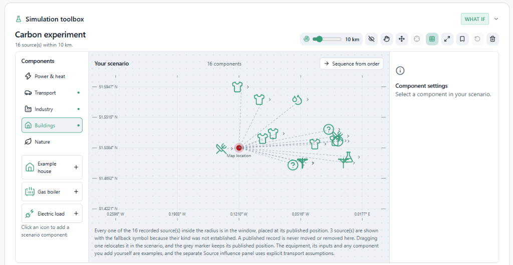

# CarbonLocality

CarbonLocality is a UK emissions explorer and simulation workspace. The explorer maps published
inventory data and lets you inspect the sources recorded around any location you choose. The
simulation side places those sources in a scenario and estimates how each one reaches a receptor
under a stated wind.

## Geographic explorer

The map carries eight measures, chosen from a layer control. They are CO2 emissions, CO2
concentration, carbon intensity, buildings, road transport, industry, energy production and satellite
CO2. The legend names the measure, its unit, the range in use and the source it comes from. Zoom, pan
and drawing controls sit over the map, and the coverage boundary stays fixed as the view moves.

Published inventory currently covers Great Britain and UK waters from the NAEI 2023 edition. The
native grid resolution as published in the record is 1 km, however, the app grid shows a 10 km mean derived from it for faster rendering. Coordinates use WGS84 and location-based analysis can be directly performed only if an express permission has been given by the user through the browser.

## Simulation workspace

The toolbox places every recorded source inside the chosen radius at the position the record states.
Dragging one relocates it for the current scenario and leaves a grey marker where the record puts it,
so both positions stay visible. Components you add yourself, such as an example house, a gas boiler or
an electric load, are held separately from the published records.

## Source influence

The influence panel estimates which eligible sources reach a selected receptor, using a reflected
Gaussian screening plume. It states the wind bearing and speed in use, and can load historical ERA5
wind for the location. It then reports the hourly profile of the estimate, a wind rose with the
bearing to each eligible source, and a source to receptor matrix.

## Data rules

Published records are evidence and are never altered. A scenario may relocate or deactivate a record's
effective position, and the published value stays as published.

Totals are never summed across publishers. EDGAR reports on AR5 and Climate TRACE on AR6, so their
figures are shown side by side rather than added together.

Observed, inventory, modelled and calculated values stay separate. A concentration is not an emission,
and a modelled estimate is never presented as an observed one. A missing value stays unavailable rather
than becoming zero.

## Limits of the calculation

The screening model assumes neutral flow over flat rural terrain. Its declared domain is 100 m to
10 km, wind from 1 to 30 m/s, and a release height from 2 m to 300 m. It has not been validated
against measurements, and it is not a street-level measurement of carbon concentration. It is not a
health assessment or a permit assessment, and it makes no claim about carbon savings.

## Licence

Emissions inventory data are published under the Open Government Licence for Great Britain.
